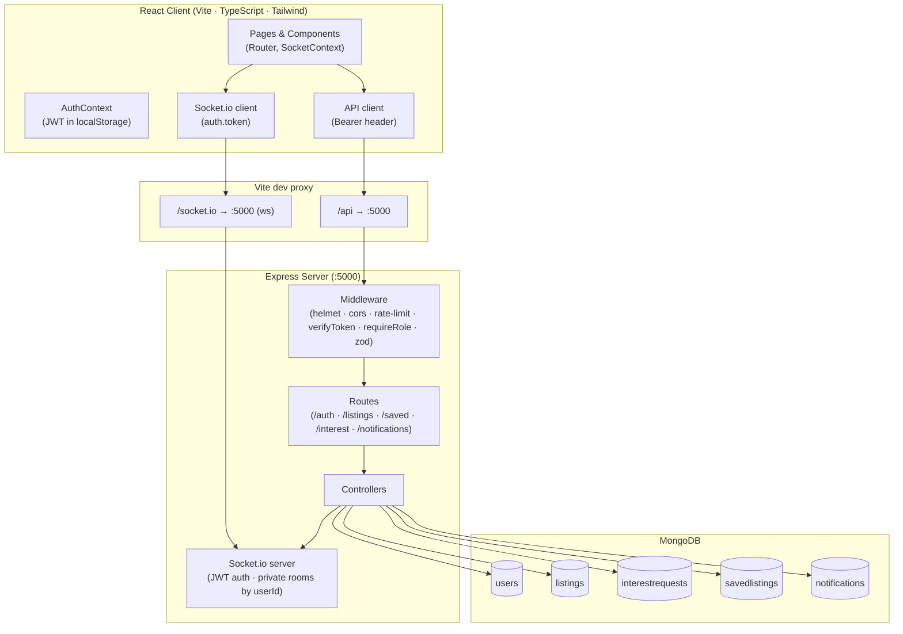
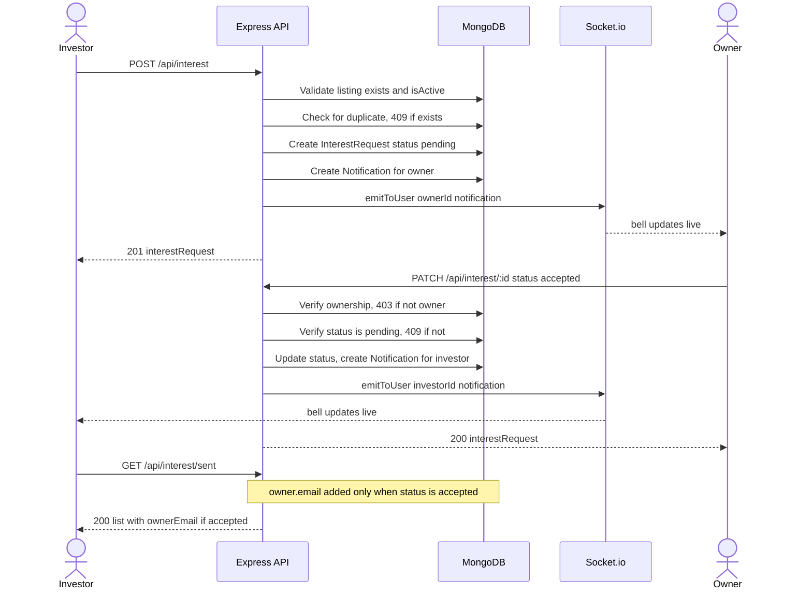
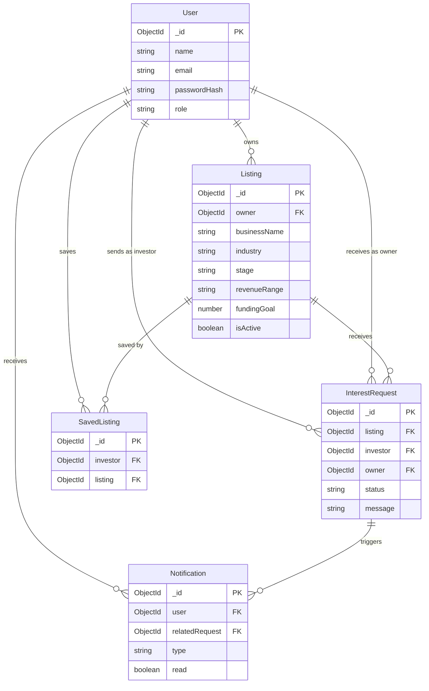

# SeedBridge

## 1. Project name and description

**SeedBridge** is a marketplace connecting small business owners with investors. Owners list their businesses; investors discover, save, and express interest in them. The platform handles discovery and connection only — no payments are processed.

---

## 2. Features

### Owner
- Register with the Owner role and create one listing per account.
- Listing fields: business name, industry, city/state, stage, annual revenue range, funding goal (₹), funding purpose, and description.
- Edit the listing and toggle it active or inactive from the dashboard. Inactive listings are hidden from browse and visible only to the owner.
- View incoming interest requests on the dashboard; accept or decline each one. Accepting reveals your contact email to that investor only.
- Receive a live notification when an investor expresses interest.

### Investor
- Register with the Investor role.
- Browse all active listings with full-text search, filters (industry, stage, city, state, funding range), sort, and pagination. All filter and sort state lives in the URL.
- Save listings with a bookmark toggle on cards and the detail page. Saved listings appear on the dashboard.
- Express interest in a listing from the detail page with an optional message. After sending, the button becomes a status badge (Pending / Accepted / Declined).
- View sent interest requests on the dashboard. The owner's contact email is shown only after the owner accepts.
- Receive a live notification when an owner accepts or declines a request.

### Both roles
- JWT authentication with role-based access control.
- Live notifications via Socket.io: a bell icon in the navbar shows an unread count, updates without page reload, and lets you mark notifications read individually or all at once.
- Responsive layout at 375 px, 768 px, and 1024 px+.

---

## 3. Technologies used

| Layer | Libraries |
|---|---|
| Database | MongoDB, Mongoose 8 |
| Server | Node.js, Express 4, Socket.io 4 |
| Validation | Zod 3 |
| Auth | jsonwebtoken 9, bcryptjs 2 |
| Security | helmet 7, express-rate-limit 7, cors 2 |
| Client | React 19, React Router 6, TypeScript 5, Vite 8 |
| Styling | Tailwind CSS 3, PostCSS |
| Fonts | Fraunces (variable), DM Sans (variable) via @fontsource-variable |
| Testing | Vitest 5, Supertest 7, mongodb-memory-server 10 |

### Architecture

Full diagrams are in [docs/ARCHITECTURE.md](docs/ARCHITECTURE.md).

#### High-level architecture



The React client sends all HTTP traffic through the Vite dev proxy to Express; Socket.io uses a separate WebSocket proxy entry on the same target. The server enforces auth and role checks in middleware before requests reach controllers, which emit socket events directly when needed.

#### Interest request flow



The owner's email is attached to sent-request responses only after acceptance; it is absent on all listing browse and detail responses.

#### Data model



`InterestRequest` denormalises `owner` from the listing at creation time so that `GET /received` can query `{ owner: userId }` without joining through `Listing`.

---

## 4. Setup and installation

### Prerequisites
- Node.js v18 or later
- A MongoDB instance — either [MongoDB Community](https://www.mongodb.com/try/download/community) running locally on port 27017, or a free [MongoDB Atlas](https://www.mongodb.com/cloud/atlas) cluster

### Clone and install

```bash
git clone https://github.com/pjha26/SeedBridge.git
cd SeedBridge

# Server dependencies
cd server
npm install

# Client dependencies
cd ../client
npm install
```

### Environment variables

**Server** — copy and fill in:

macOS / Linux:
```bash
cd server
cp .env.example .env
```

Windows PowerShell:
```powershell
cd server
Copy-Item .env.example .env
```

Open `server/.env` and set at minimum:
- `MONGO_URI` — your MongoDB connection string (e.g. `mongodb://localhost:27017/seedbridge`)
- `JWT_SECRET` — any random string of **at least 32 characters**

**Client** — the client uses Vite's proxy for all API calls and does not require a `.env` file in development. The `client/.env.example` file is provided for reference only.

---

## 5. How to run

Open two terminals.

**Terminal 1 — server**
```bash
cd server
npm run dev
```
Runs on `http://localhost:5000`. You should see `MongoDB connected`.

**Terminal 2 — client**
```bash
cd client
npm run dev
```
Runs on `http://localhost:5173`.

**Seed sample data** (optional — run once in a third terminal after the server is up):
```bash
cd server
npm run seed
```

**Run API tests** (does not require a running server or database):
```bash
cd server
npm test
```
> Note: the first run downloads a MongoDB binary (~70 MB) used by mongodb-memory-server. Subsequent runs use the cached binary and start in a few seconds.

### Demo accounts

The seed script creates these accounts. They are **development-only sample data** and should never be used in production.

Password for all accounts: `SeedBridge2024!`

| Email | Role |
|---|---|
| seed__rohan@example.com | Owner |
| seed__ananya@example.com | Owner |
| seed__suresh@example.com | Owner |
| seed__fatima@example.com | Owner |
| seed__arjun@example.com | Owner |
| seed__meera@example.com | Owner |
| seed__deepak@example.com | Owner |
| seed__shreya@example.com | Owner |
| seed__vikram@example.com | Investor |
| seed__priya@example.com | Investor |

---

## 6. AI tool used

Kiro. I built the project in the Kiro IDE (specs, steering rules and code generation). I also used a general-purpose AI assistant (Claude) for planning, drafting prompts for Kiro, and reviewing results.

---

## 7. AI development experience

I used Kiro throughout the project as a coding assistant working from a spec. Before writing any code, I created requirements and design documents in `.kiro/specs/` and a set of project rules in `.kiro/steering/project-rules.md` that covered server layering, enum placement, validation rules, and commit conventions. From there I worked in small steps — one feature area at a time (models, auth, listings, saved, interest, notifications, dashboard, tests) — delegating implementation to Kiro and reviewing each output before moving on. I tested manually in the browser and against the API using `server/requests.http`, compared actual JSON responses to what the code claimed to return, and reported any discrepancies back to Kiro to fix. Each feature area was committed separately so the history is readable and individual changes are easy to revert.

---

## 8. Specific AI-assisted tasks

**1. Enum design — revenue range key renamed from `"0"` to `"none"`**

Kiro's first draft used `"0"` as the key for the pre-revenue range. I flagged that `"0"` is falsy in JavaScript and would cause silent bugs in conditional checks (`if (listing.revenueRange)`). I asked Kiro to rename it to `"none"` and to consolidate all enum values into a single `server/src/config/constants.js` file so the client and server always read from the same source. The change was made and the client constants mirror was updated in the same commit.

**2. Listing detail page crashed with a blank screen**

After the listings browse page was working, navigating to a detail URL produced a completely blank screen. I opened the browser console, found a TypeError on `listing.owner.name`, and checked the Network tab — the API response was `{ listing: { ... } }` but the component was calling `setListing(data)` treating the whole envelope as the listing. Kiro fixed the unwrapping (`data.listing`) and also added a top-level React error boundary so future render errors show a readable fallback instead of a blank page.

**3. Owner email exposed on the public listing detail**

During manual testing I opened `GET /api/listings/:id` in DevTools and saw `owner.email` in the JSON. The populate call was using `'name email'` as the field selector instead of `'name'`. I reported it and Kiro corrected every `.populate('owner', ...)` call in the codebase to select `name` only. The rule was also written into the project steering file so it would be enforced on all future work. Email is now returned only in the investor's own sent-requests list after the owner accepts.

**4. Windows: generated curl commands didn't work in PowerShell**

Kiro initially suggested verifying endpoints with `curl | jq` shell commands. These don't work in Windows PowerShell without extra quoting and `jq` isn't installed by default. I asked Kiro to write `server/requests.http` instead — a file that works with the REST Client extension in VS Code (and with any tool that reads the HTTP file format). All new routes are documented there with placeholder comments instead of real tokens.

**5. Browse cards: bookmark overlapped stage tag and description was missing**

After the listings browse page launched, the bookmark icon sat directly on top of the stage badge in the card header and the 2-line description preview was absent from cards. I reported both issues and Kiro moved the bookmark into the card footer row (beside "View details →") and confirmed the description was already rendered but the CSS `line-clamp` wasn't visible without sufficient content. Both were fixed in a single commit.

---

## Known tradeoffs

- **Listings require login to browse.** The GET /api/listings browse endpoint requires a JWT. A logged-out visitor cannot see listings without registering first. This was a deliberate product decision; it can be changed to `optionalAuth` if public browse is needed.
- **Register endpoint leaks whether an email is taken.** POST /api/auth/register returns 409 with a message when the email already exists. This is a common tradeoff between usability and email enumeration risk.
- **JWT stored in localStorage.** The token is stored in `localStorage` and sent as a `Bearer` header. This avoids CSRF entirely (no cookies) but means any XSS script on the page can read the token. The defence is preventing XSS through React's default escaping and input validation. An `httpOnly` cookie approach would remove this risk at the cost of needing CSRF protection.

---

## Future improvements

- Email notifications (SendGrid or similar) in addition to in-app Socket.io notifications.
- Paid listing plans with Stripe — owners on a free plan get one listing; paid plans allow multiple or featured placement.
- Document uploads on listings (pitch decks, financials) stored in S3 or Cloudinary.
- Admin panel for moderating listings and managing users.
