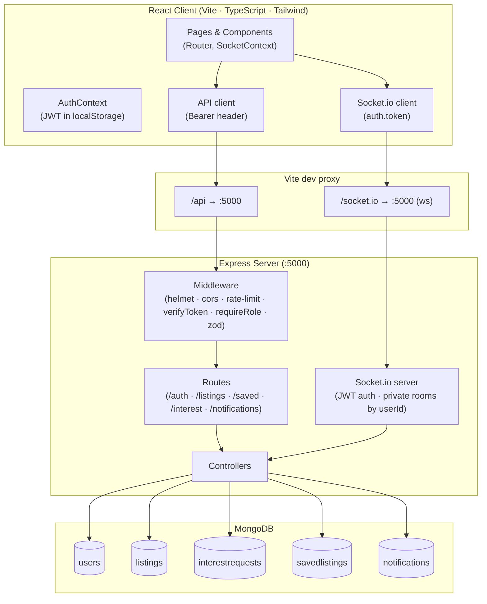
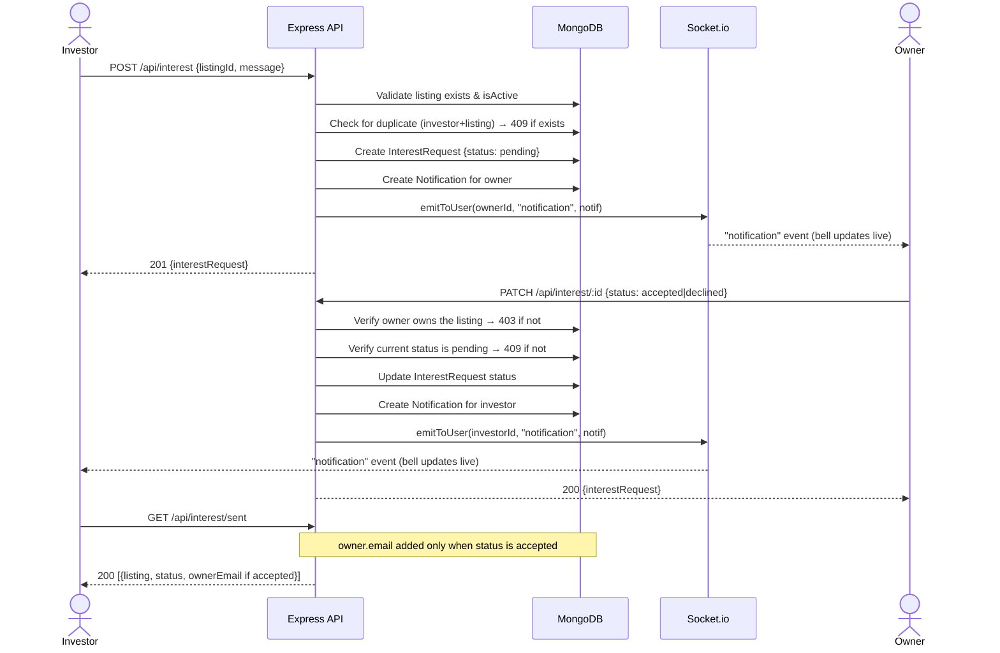
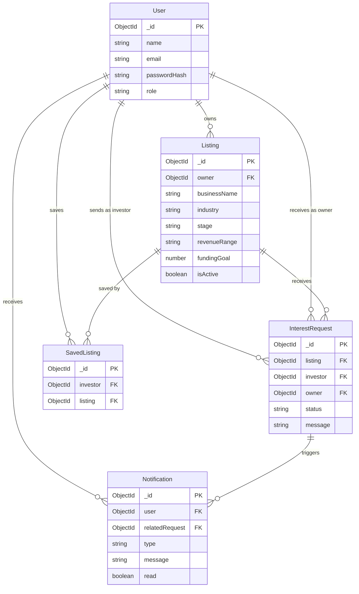

# SeedBridge — Architecture

## 1. High-level architecture

The React client sends all HTTP traffic through the Vite dev proxy to Express; Socket.io uses a separate WebSocket proxy entry on the same target. The server enforces auth and role checks in middleware before requests reach controllers, which are the only layer that touches MongoDB.

---

## 2. Interest request flow

The owner's email is fetched from the User collection and attached to the response only for accepted requests in `GET /api/interest/sent`; it is never present on listing browse or detail responses.

---

## 3. Data model

`InterestRequest` denormalises `owner` from the listing at creation time so that `GET /received` can query by `{ owner: userId }` directly without joining through `Listing`. `SavedListing` uses a compound unique index on `{investor, listing}` to make saving idempotent at the database level.
